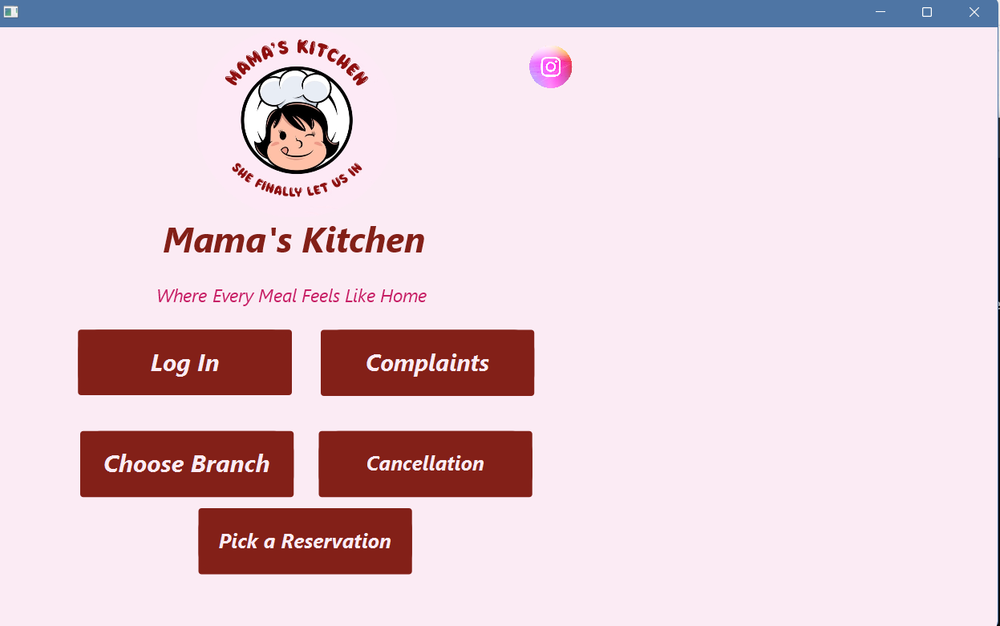
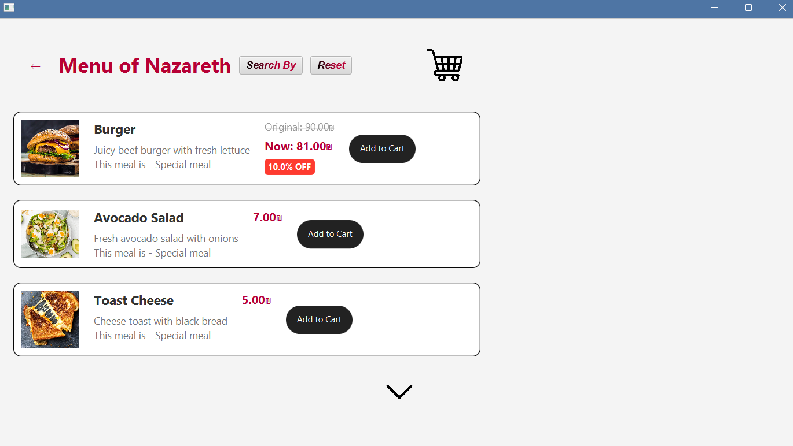
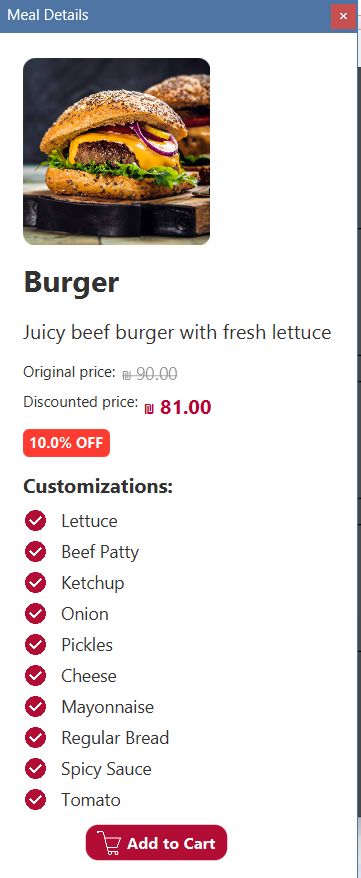
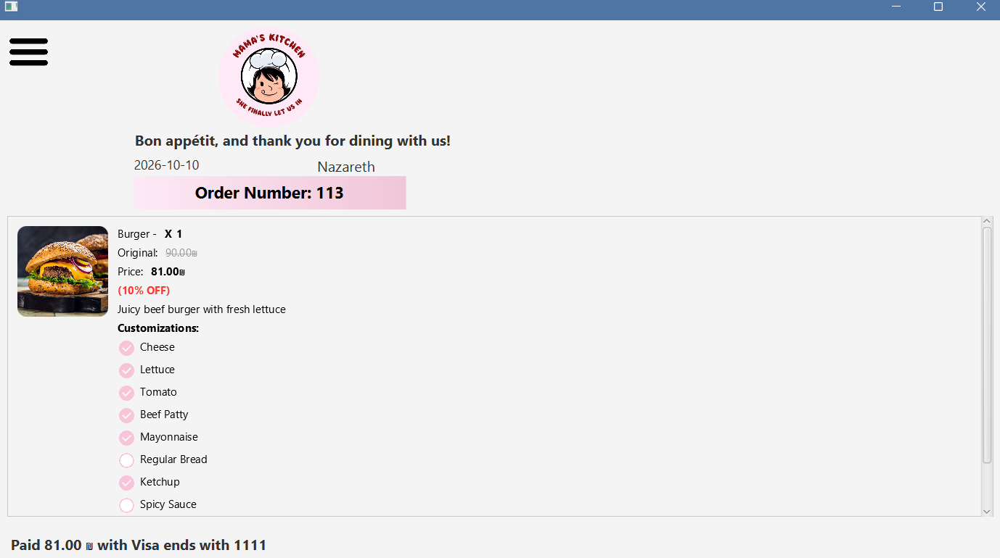
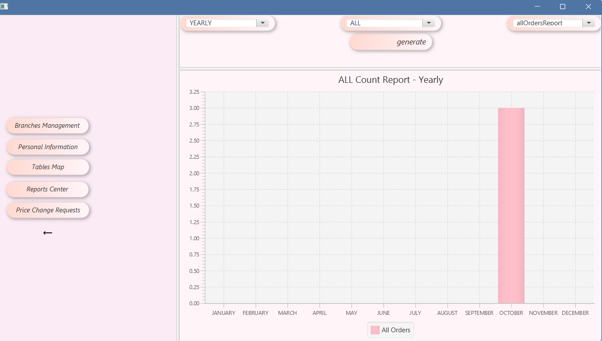
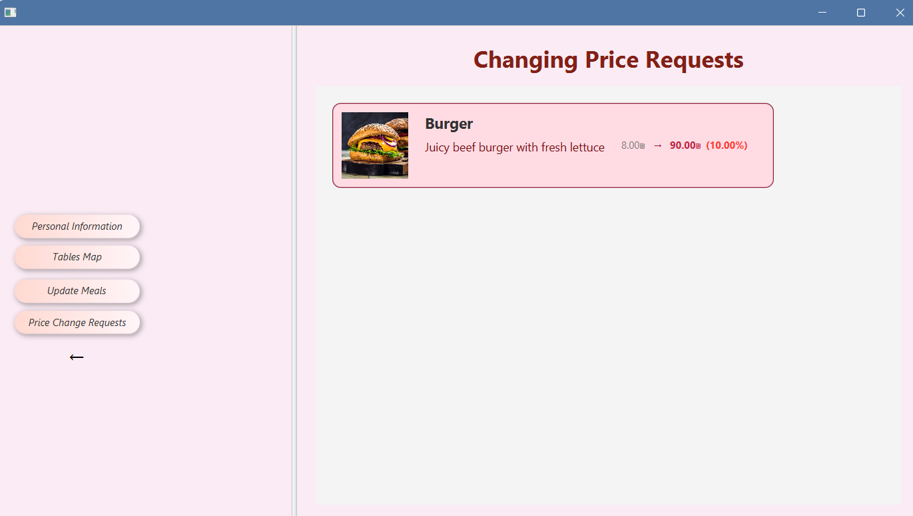
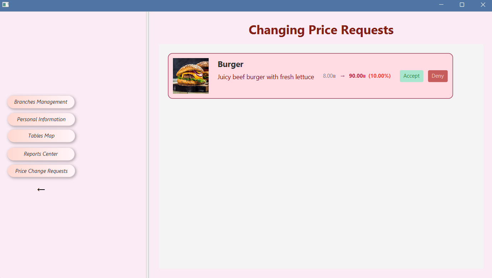

# Mama's Kitchen: Restaurant Chain Management System

A Java client-server desktop application for a restaurant chain with four branches. Customers can browse branch menus, order for delivery or pickup, reserve tables and submit complaints. Staff get role-based screens for managing meals and prices, approving requests, handling complaints and viewing reports.

> Final team project (8 students) for the Software Engineering course, B.Sc. in Computer Science, University of Haifa, Winter 2024–2025. See [My Contribution](#my-contribution) for the parts I built.

<p align="center">
  
</p>

## Key Features

**Customers** (no login required)
- Browse the menu of each branch (Haifa, Nazareth, Tel Aviv, Sakhnin), with discounted prices shown
- Customize meals (add or remove ingredients) and filter the menu by ingredient or branch
- Cart, checkout and payment, with delivery or self pickup, plus an order receipt
- Reserve tables by branch, time and seating area (inside or outside)
- Cancel an order or a reservation
- Submit complaints, suggestions or feedback

**Staff** (role-based login)
- **Dietitian**: add, update and delete meals, edit customizations and branch availability, and submit price or discount change requests
- **Company manager**: approve or deny price change requests, manage workers, and view reports
- **Customer service**: respond to complaints, filter them by type and status, and set refund amounts. Complaints with no response get an automatic reply after 24 hours
- **Branch roles** (branch manager, host, kitchen) have their own staff accounts and screens

**Reports**: order counts (all, delivery, pickup), revenue, complaints and visitors. Each report can be generated monthly or yearly, per branch or for the whole chain, and is displayed as a chart.

## Screenshots

| Branch menu | Meal details |
|---|---|
|  |  |

| Order receipt | Reports |
|---|---|
|  |  |

| Price change request (dietitian view) | Approval (manager view) |
|---|---|
|  |  |

## Technologies

| Area | Technology |
|---|---|
| Language | Java 17 (source level) |
| Desktop UI | JavaFX 23 with FXML and CSS |
| Client-server communication | OCSF (Object Client-Server Framework) over TCP sockets |
| Event handling (client) | GreenRobot EventBus |
| Persistence | Hibernate ORM 5.4 with MySQL 8 |
| Email | JavaMail over SMTP (Mailjet), optional |
| Build | Maven (multi-module) |

## Architecture

The project is a Maven multi-module build:

```
ProjectSoftwareEng/
├── client/     JavaFX desktop app: FXML screens, controllers, OCSF client
├── server/     OCSF server: request handling, Hibernate data access, reports
├── entities/   Shared serializable model classes used by both client and server
└── docs/screenshots/
```

- The **client** sends serializable request objects (from `entities`) to the server over a socket. Server responses are published on an **EventBus**, so controllers stay decoupled from the networking code (Mediator pattern).
- The **server** handles each request, reads and writes MySQL through **Hibernate**, and sends a result back to the client or broadcasts it to all connected clients.
- **Reports** use the **Strategy pattern**. `ReportStrategy` is implemented by `RevenueReport`, `OrderTypeReport`, `ComplainReport` and `VisitorsReport`, and selected at runtime through `ReportContext`.
- On first start, the server creates the schema (`hbm2ddl.auto=update`) and seeds demo data: branches, meals, tables, staff accounts and sample orders.

## Getting Started

> Built and tested on **Windows**. The client's JavaFX graphics dependency is currently configured for Windows (`classifier: win` in `client/pom.xml`).

### Prerequisites
- **JDK 21 or newer** (JavaFX 23 requires Java 21+; tested with JDK 23)
- **Maven 3.x**, or an IDE with Maven support such as IntelliJ IDEA
- **MySQL 8** running locally on port 3306

### 1. Create the database
The server creates the tables, but not the database itself:
```sql
CREATE DATABASE projectdatabase;
```
The connection settings (URL and username `root`) are in `server/src/main/resources/hibernate.properties`. Change them there if your setup is different.

### 2. Build
From the project root:
```
mvn clean package -DskipTests
```
This produces two runnable JARs:
- `server/target/server-0.0.1-SNAPSHOT-jar-with-dependencies.jar`
- `client/target/client-0.0.1-SNAPSHOT.jar`

### 3. Run
Run each command in its own terminal, from the project root.

```
java -jar server/target/server-0.0.1-SNAPSHOT-jar-with-dependencies.jar
```
The server asks for your MySQL password, connects, seeds the data on first run, and listens on port **3000**.

```
java -jar client/target/client-0.0.1-SNAPSHOT.jar
```
On the first screen, enter host `localhost` and port `3000`. You can run several clients at the same time.

### Email (optional)
By default the app runs in **development mode**: instead of sending emails, it prints them, including verification codes for reservations and new workers, to the **client** terminal. To send real emails through Mailjet, set these environment variables before starting the client:

| Variable | Description |
|---|---|
| `MAILJET_API_KEY` | Mailjet API key |
| `MAILJET_SECRET_KEY` | Mailjet secret key |
| `MAIL_FROM` | Verified sender address |

### Demo accounts
Created automatically on first run. Customers don't need an account.

| Role | Username | Password |
|---|---|---|
| Company manager | `ceo` | `212` |
| Dietitian | `shada` | `123` |
| Customer service | `yousef` | `123` |
| Branch manager (Nazareth) | `adan` | `123` |
| Host (Nazareth) | `lamis` | `123` |
| Kitchen (Nazareth) | `kitchen` | `123` |

For payment, use a test card number such as `4111 1111 1111 1111`.

### Troubleshooting
- **`Communications link failure` / `Connection refused`**: MySQL isn't running. Start the MySQL service and try again.
- **`Failed to delete ... .jar` during `mvn clean`**: a server or client is still running and locking its JAR. Stop both, then rebuild.
- **Code changes don't show up**: rebuild with `mvn clean package -DskipTests` before running again. Both JARs include the shared `entities` module.

## My Contribution

I worked across the client, server and shared entities. The main parts I built:

- **Reports system**: the Strategy-based report design (`ReportStrategy`, `ReportContext` and the revenue, order-type, complaint and visitors reports), the Hibernate Criteria API queries in `ReportDB` (monthly and yearly, per branch or chain-wide), and the reports screen with JavaFX charts.
- **Role-based staff interface**: the worker and company-manager screens, where each role sees its own menu after login.
- **Meal management and price change workflow**: updating meals and their customizations, dietitian price or discount requests, and the manager approval screen.
- **User management**: the screen for adding, updating and deleting workers.
- **Together with a teammate**: the initial MySQL/Hibernate setup and core entities (`Meal`, `Customization`, `Order`), and order and reservation cancellation.

The full list of contributors is on the repository's [Contributors](https://github.com/Nagham1023/ProjectSoftwareEng/graphs/contributors) page.

## Known Limitations

This is an academic project and is not production-ready. Known issues:

- **Security**: user passwords are stored in plain text, and payment card details, including CVV, are stored in the database. A real system would hash passwords and never store full card data.
- **Email credentials live in the client**: emails are sent from the desktop client, which means a real deployment would ship SMTP credentials to every user. Sending email from the server would be the correct design.
- **Tests**: there are no meaningful automated tests (only the Maven template test).
- **Platform**: the client build is configured for Windows only.
- **Time zone**: reservation times are stored in UTC and shown in local time, so raw values in the database differ from the UI by the local offset.